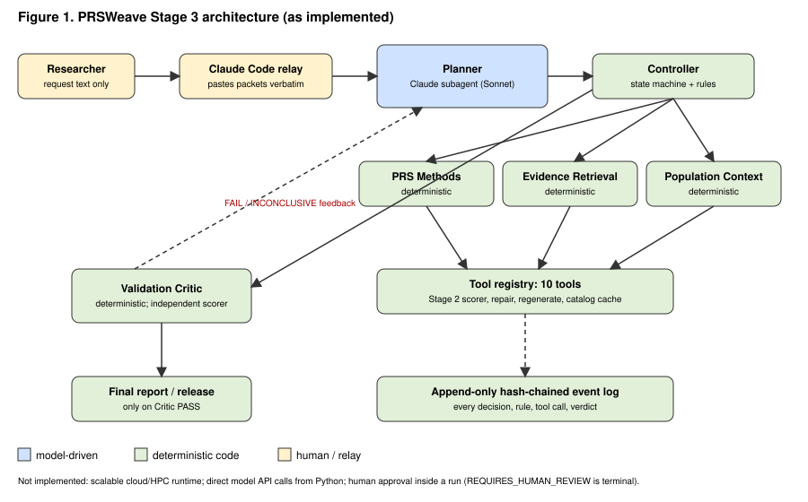

# PRSWeave Stage 3 Architecture (as implemented)

## Components and what they actually are

| Component | File | Kind | Model? |
|---|---|---|---|
| Planner / Orchestrator | `src/prsweave/agents/planner.py` (contract) | **Claude Code subagent** (Sonnet), a fresh one per run, continued with SendMessage | **Yes**, the only model-driven component |
| Evidence Retrieval | `src/prsweave/agents/evidence.py` | Deterministic specialist (PGS Catalog and GWAS Catalog REST with a provenance cache; Stage 1 score index) | No |
| Population Context | `src/prsweave/agents/population_context.py` | Deterministic specialist (phenotype-site vocabulary comparison, coverage, effect alleles, eligibility of alternatives) | No |
| PRS Methods | `src/prsweave/agents/prs_methods.py` | Deterministic specialist wrapping the unmodified Stage 2 loader and scorer; two self-verifying corrective tools | No |
| Validation Critic | `src/prsweave/agents/validation_critic.py` | Deterministic verifier with authority to reject; recomputes scores with `validation/independent_scorer.py` in an isolated interpreter | No |
| Controller | `src/prsweave/orchestration/controller.py`, `state.py` | Deterministic state machine, authorization rules and retry bounds | No |
| Tool registry | `src/prsweave/orchestration/tool_registry.py` | 10 executable tools; every call writes argument and result artifacts and an event | No |
| Event log | `src/prsweave/orchestration/event_log.py` | Append-only, SHA-256 hash-chained JSONL | No |
| Relay | Claude Code main session | Pastes each packet to the Planner and saves its reply verbatim | It is a model, but it is not a PRSWeave agent and makes no workflow decisions |
| Harness | `experiments/stage3/run_experiments.py` | Builds inputs, injects faults, assigns opaque run IDs; its log is hidden from the Planner and Critic | No |
| Independent evaluator | `evaluation/independent_evaluator.py` | Rubric grading; imports no agent or orchestration code | No |

The specialists are deliberately deterministic. Calling them "agents" refers to their role, not to autonomy.

## One Planner turn

1. The controller writes `packets/packet_NNN.json`, containing the request, state, budgets, permitted and blocked actions, the last tool result, the Critic's feedback and the history. The scenario label, expected outcome and rubric are never included.
2. The relay renders `relay_NNN.txt` (from packet 9 on, checked to be JSON-equal to the packet) and pastes it to the subagent.
3. The subagent returns one JSON decision. The relay saves it verbatim as `decisions/reply_NNN.txt`.
4. The controller logs a `relay` event (packet and reply SHA-256, latency, reported tokens and tool uses) and then an `llm_decision` event. Both are logged before anything runs.
5. A `deterministic_rule` event authorizes or rejects the action (unknown action, wrong arguments, unmet precondition, retry bound).
6. If authorized, the action executes through the registry (`tool_execution`) or the Critic (`verification_judgment`), followed by `state_transition` events.

## States

`INITIALIZED → EVIDENCE_RETRIEVED → ELIGIBILITY_CHECKED → PLAN_APPROVED → EXECUTING → VALIDATING → COMPLETED`

- Replanning: `EXECUTING/VALIDATING → REPLAN_REQUIRED → {EVIDENCE_RETRIEVED, ELIGIBILITY_CHECKED, PLAN_APPROVED, EXECUTING}`.
- Terminal states, reachable from any live state: `ABSTAINED`, `FAILED`, `REQUIRES_HUMAN_REVIEW`.
- Bounds: at most 2 recovery cycles and 14 Planner decisions; 3 consecutive invalid decisions end the run as `FAILED`.

## Critic checks (judgment PASS / FAIL / INCONCLUSIVE)

| ID | Check | Retry allowed on FAIL |
|---|---|---|
| V1 | Scoring file SHA-256 equals the DR-0001 pin | No |
| V2 | Harmonized weights equal the catalog's original deposited weights (Stage 1 file) | No |
| V3 | The genotype file is an original input or a logged, cell-verified derivative of one | Yes |
| V4 | The scores file is unchanged since `calculate_prs` wrote it | Yes |
| V5 | Independent recomputation agrees (absolute tolerance 1e-9, equal `n_used`) | Yes |
| V5b | Withheld individuals carry no score | Yes |
| V6a | The phenotype label names total-body BMD and no other site | Yes |
| V6b | The requested site corresponds to the score's site, and the submission claims it fulfils the request | No if the sites differ; yes if only the claim is malformed (Amendment 2) |
| V7 | Summary: no un-negated forbidden terms; every number traceable; mentions "synthetic" and "total-body" | Yes |

## Provider independence

The tools, the controller and the Critic take no model dependency. A planner hosted by any other model provider or computing platform would need only to:
1. read `packet_NNN.json`,
2. return the same JSON decision schema (`planner.REQUIRED_KEYS`),
3. call `Controller.apply_decision`.

This has not been implemented or tested.
